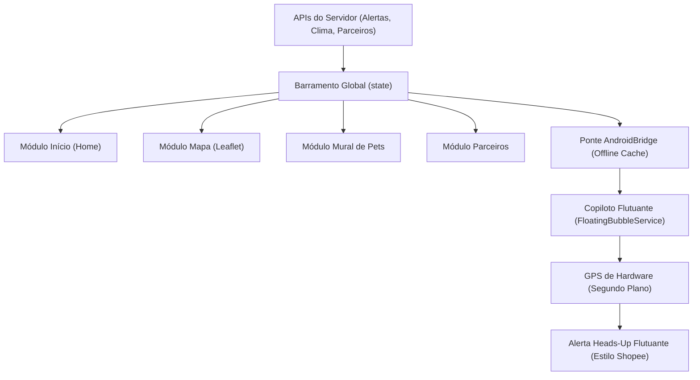

# MANUAL DE ESTRUTURA DAS ABAS & BÍBLIA ARQUITETURAL
## Alerta Pet Brasil • Alerta Urbano Cascavel
> **Autoridade Suprema:** Rigo  
> **Arquiteto Chefe de Sistemas:** Johan  
> **Data de Atualização:** Novembro de 2026  
> **Localização dos Módulos:** `c:\PROJETOS\5-FERRAMENTAS\ALERTA_URBANO_CASCAVEL\modulos_app\`  
> **Script de Compilação:** `build_modular.py`  
> **Pasta de Backup Homologada:** `c:\PROJETOS\5-FERRAMENTAS\ALERTA_URBANO_CASCAVEL\componentes\`

---

## 1. VISÃO GERAL & OBJETIVO DA MODULARIZAÇÃO

Este documento é a **Bíblia Técnica Oficial** do aplicativo Alerta Pet Brasil / Alerta Urbano Cascavel. Ele foi projetado para:
1. **Blindar o aplicativo contra quebras acidentais:** Acabar com o monólito gigante de mais de 12.000 linhas em um único arquivo, onde editar uma aba trazia o risco de desalinhar botões, esteiras ou quebrar o JavaScript de outras abas.
2. **Modularização por Abas e Componentes:** Dividir o código em arquivos isolados e enxutos dentro de `modulos_app/`. Ao alterar a Aba Início, mexe-se **apenas** no arquivo da Aba Início; ao alterar a Aba Parceiros, mexe-se **apenas** no arquivo de Parceiros.
3. **Facilidade de Handoff e Manutenção:** Se no futuro qualquer programador assumir o projeto, ele terá em mãos este mapa completo, com cores, IDs, funções e fluxo de dados documentados.

---

## 2. AVALIAÇÃO ARQUITETURAL: RUNTIME FETCH VS. COMPILADOR ATÔMICO

O Rigo e a equipe técnica avaliaram duas estratégias para organizar o aplicativo:

### Opção A: Carregamento sob demanda via `fetch()` (Runtime Components)
* **Como funciona:** O `index.html` fica vazio e carrega cada aba via requisição `fetch('/abas/inicio.html')` toda vez que o usuário clica no menu.
* **Por que foi DESCARTADA:** O Alerta Pet Brasil é utilizado no trânsito por motoristas e protetores em movimento. Se o sinal 4G oscilar em uma rua ou bairro com pouca cobertura, fazer requisições de rede ao trocar de aba causaria:
  - Telas brancas de carregamento ("loading...").
  - Atraso (lag) na resposta ao toque.
  - Quebra na inicialização de mapas pesados (Leaflet precisa de nós DOM fixos para calcular renderização de pixels).

### Opção B: Sistema de Montagem Modular com Compilador Atômico (`build_modular.py`) — ESCOLHA OFICIAL
* **Como funciona:**
  - O código fonte do desenvolvedor fica 100% dividido em arquivos pequenos e limpos dentro de `modulos_app/` (cada arquivo com 100 a 400 linhas).
  - Um script Python leve (`build_modular.py`) junta os módulos e gera o `static/index.html` em menos de **0,1 segundo**.
  - O script faz uma **auditoria de integridade** antes de salvar: verifica se todas as 5 abas existem, se as funções essenciais estão presentes e se as tags estão balanceadas.
* **Vantagens Absolutas:**
  - **Zero Risco de Contaminação:** Alterar `01_aba_inicio.html` jamais afetará o código da Aba Pets ou do Mapa.
  - **Performance Máxima no Celular:** O navegador e a WebView do Android carregam um arquivo único otimizado, sem atrasos de rede e funcionando 100% offline.
  - **Deploy Automático:** O script já copia o arquivo final para o repositório de produção (`DEPLOY_NUVEM_ALERTA_URBANO`).

---

## 3. ESTRUTURA DE PASTAS E ARQUIVOS

```text
c:\PROJETOS\5-FERRAMENTAS\ALERTA_URBANO_CASCAVEL\
│
├── modulos_app/                         <-- ONDE O DESENVOLVEDOR EDITA O CÓDIGO
│   ├── abas/
│   │   ├── 01_aba_inicio.html           (Aba Início: Clima, Campanha, Esteira Pets, Protetores, Apoie Aqui)
│   │   ├── 02_aba_mapa.html             (Aba Mapa: Mapa Leaflet, Pílulas, Trilha de Rastro, Satélite)
│   │   ├── 03_aba_pets.html             (Aba Pets: Rede de Proteção, 4 Pilares, Grid de Animais)
│   │   ├── 04_aba_parceiros.html        (Aba Parceiros: Empresas Parceiras, Filtros de Categorias)
│   │   └── 05_aba_copiloto.html         (Aba Copiloto: Hero Patinha, Locutores, Switches, Ritmo 6h/12h/24h)
│   │
│   └── partes/
│       ├── 00_header_e_estilos.html     (Cabeçalho HTML, Metatags, Fontes e Folhas de Estilos CSS)
│       ├── 01_topo_e_shell.html         (Topo do app, Patinha animada no header, Barra de cidade)
│       ├── 03_rodape_e_dock.html        (Barra de Navegação Inferior de 4 itens)
│       ├── 04_modais_e_drawers.html     (Modais de Cadastro, Detalhes de Pet, Seja Parceiro e Guias)
│       └── 05_scripts_motor.html        (Todo o código JavaScript do motor do aplicativo)
│
├── componentes/                         <-- BACKUP DOS BLOCOS 100% HOMOLOGADOS
│   ├── esteira_apoio.html               (Blocos do Apoie Aqui sem bordas verdes)
│   ├── aba_inicio.html                  (Aba Início completa homologada)
│   ├── aba_mapa.html                    (Aba Mapa completa homologada)
│   ├── aba_pets.html                    (Aba Pets completa homologada)
│   ├── aba_parceiros.html               (Aba Parceiros completa homologada)
│   ├── aba_copiloto.html                (Aba Copiloto completa homologada)
│   └── patinha_flutuante_chroma.html    (Patinha viva SVG pura)
│
├── build_modular.py                     <-- COMPILADOR ATÔMICO
└── static/index.html                    <-- ARQUIVO FINAL GERADO AUTOMATICAMENTE
```

---

## 4. A BÍBLIA DOS 3 PILARES POR ABA

---

### ABA 1: INÍCIO (`id="tab-inicio"`)

#### Pilar 1: Visual (Design System)
* **Cores Oficiais:**
  - Fundo do corpo central: `#EDE8DF` (Areia Arenoso Suave).
  - Cards de Destaque (Campanha e Protetores): `#E4D5BC` (Areia Dourada Arenosa Oficial), **SEM BORDAS / SEM MARGEM MARROM** (`border: none !important;`).
  - Bloco Meteorológico: Degradê Verde-Brasil (`#009B3A` a `#007028`) com texto e números brancos (`#FFFFFF`).
  - Blocos da Esteira Apoie Aqui: Fundo `#FFFFFF`, **SEM BORDAS VERDES** (`border: none !important;`), cantos arredondados `border-radius: 12px;`.
  - Esteira Quem Ama Cuida: **CORTE RETO PURO NAS LATERAIS** (`mask-image: none !important;`), com zero efeito degradê, zero máscara fosca ou esfumaçada. Os cards entram e saem em linha reta perfeita.
  - Texto Principal dos Títulos: `#2E2417` (Marrom Terroso Profundo).
  - Subtítulos e Rótulos: `#5A4730` e `#6E5A3C`.
* **Métrica de Suspiro Oficial (Rigo):**
  - Suspiro vertical rigorosamente calibrado em **8.0px** entre todas as 4 seções:
    1. Card de Campanha (`height: 70px; font-size: 13.5px;`).
    2. Suspiro: `8px`.
    3. Esteira "Quem ama, cuida e procura junto".
    4. Suspiro: `8px`.
    5. Card Único Grande da Comunidade de Protetores (`.showcase-protetor-card` em `#E4D5BC`).
    6. Suspiro: `8px`.
    7. Esteira "Apoie Aqui" (quadradinhos brancos fluidos).

#### Pilar 2: Motor (Comportamento & Interações)
* **Rotação de Protetores:** O card da Comunidade de Protetores exibe **apenas 1 protetor por tela** em tamanho grande, com sua mini-galeria de pets. Alterna automaticamente a cada 6 segundos ou por deslize do dedo (swipe horizontal).
* **Esteira Quem Ama Cuida:** Animação contínua e suave exibindo cards de pets desaparecidos. O clique em um card abre o modal de detalhes do pet.
* **Esteira Apoie Aqui:** Rola horizontalmente de forma suave. O clique abre as informações da campanha de apoio à causa animal.
* **Ticker Meteorológico:** Carrossel de texto com avisos climáticos da Defesa Civil.

#### Pilar 3: Dados & Comunicação
* **Leitura de Dados:**
  - Clima: `/api/clima?cidade=Cascavel` ➔ alimenta `state.clima`.
  - Pets: `/api/alertas?cidade=todas` ➔ filtra pets com status "desaparecido".
  - Parceiros/Protetores: `/api/parceiros` e lista de protetores cadastrados.

---

### ABA 2: MAPA (`id="tab-mapa"`)

#### Pilar 1: Visual
* **Mapa Full Screen:** Container `#map` ocupando 100% da viewport útil.
* **Pílulas de Filtro do Topo:**
  - Pílula Ativa: Fundo Verde Brasil `#009B3A`, texto branco `#FFFFFF`.
  - Pílula Inativa: Fundo `#E4D5BC`, texto `#2E2417`.
* **Barra de Rastro (`#trail-bar`):** Fundo `#E4D5BC`, borda suave e botão vermelho cívico `✕ Sair`.
* **Botões Flutuantes:** SAT (Alternar Satélite ESRI / Ruas Carto HD) e Centralizar no Usuário (GPS).

#### Pilar 2: Motor
* **`filtrarMapa(pilar, btn)`:** Alterna visualização entre pets desaparecidos e empresas parceiras.
* **`alternarSatelite()`:** Troca a camada base do Leaflet entre tiles vetoriais e fotos de satélite de alta resolução.
* **`centralizarNoUsuario()`:** Utiliza o GPS do celular para dar zoom na localização atual do condutor.
* **`marcarAvistamento()`:** Permite ao condutor marcar um ponto de avistamento com 1 único toque.

#### Pilar 3: Dados & Comunicação
* **Leitura:** Consome o array central `state.alertas` e renderiza os marcadores coloridos com base na latitude e longitude.
* **Geolocalização:** Lê continuamente do hardware do celular via `navigator.geolocation` ou ponte Android nativa.

---

### ABA 3: PETS (`id="tab-pets"`)

#### Pilar 1: Visual
* **Identidade por Gênero do Animal:**
  - Fêmea: Rosa Suave `#FFE0EE`, texto e botões `#831843`.
  - Macho: Azul Suave `#DCF0FF`, texto e botões `#0C4A6E`.
  - Indefinido / Aves: Roxo/Lavanda `#EAE0FF`, texto e botões `#4C1D95`.
* **Cabeçalho Slim Congelado:** Pílulas de cadastro rápido horizontais e segmentação em 4 pilares:
  1. Desaparecidos
  2. Resgate
  3. Finais Felizes (Reencontrados)
  4. Para Adoção

#### Pilar 2: Motor
* **`alternarPilarPet(pilar)`:** Filtra o grid de pets em memória instantaneamente.
* **`abrirModalPet(tipo)`:** Abre o formulário limpo para cadastrar um animal.
* **Botão Contatar Tutor:** Dispara mensagem formatada direta para o WhatsApp do tutor ou protetor responsável.

#### Pilar 3: Dados & Comunicação
* **Persistência:** Envia cadastros e avistamentos via POST para `/api/pets`.
* **Cache Local:** Todos os dados da lista são armazenados em `localStorage` para consulta instantânea mesmo se o condutor entrar em uma área sem sinal.

---

### ABA 4: PARCEIROS (`id="tab-parceiros"`)

#### Pilar 1: Visual
* **Cabeçalho Areia Oficial:** Card superior `#E4D5BC` com título "Empresas Parceiras" e subtítulo "Comércio Amigo dos Animais".
* **Botão "Seja Parceiro":** Verde esmeralda `#009B3A` com sombra acolhedora.
* **Carrossel de Categorias:** Pílulas deslizantes para Veterinárias, Pet Shops, Rações, Farmácias e Serviços.

#### Pilar 2: Motor
* **`filtrarCategoriaParceiro(categoria, btn)`:** Filtra a lista instantaneamente sem recarregar a tela.
* **`abrirModalSejaParceiro()`:** Abre o formulário para lojistas de Cascavel cadastrarem sua empresa na rede colaborativa.
* **Card Interativo:** Toque no telefone liga direto; toque no WhatsApp abre conversa com a loja.

#### Pilar 3: Dados & Comunicação
* **Leitura:** Consome `/api/parceiros` e sincroniza fotos do diretório `/static/darkplanner_pessoas/` e logos parceiras.

---

### ABA 5: COPILOTO (`id="tab-copiloto"`)

#### Pilar 1: Visual
* **Hero da Patinha:** Card areia `#E4D5BC` com a Patinha Viva em SVG Chroma Key amarelo `#FED700` no centro.
* **Botão ATIVAR PATINHA:** Verde Brasil `#009B3A` com destaque táctil e sombra de elevação.
* **Botão DESATIVAR PATINHA:** Bege claro `#FAF7F2` com borda suave.
* **Seletores de Voz:** Pílulas para Natália (Feminina Oficial) e Guido (Masculino Oficial).
* **Ritmo de Busca na Cidade:**
  - 6 em 6 horas: Busca Intensiva (⚡ Amarelo).
  - 12 em 12 horas: Busca Ativa (🧭 Bege).
  - 24 horas: Busca Padrão Oficial (🛡️ Verde Brasil - Recomendado).

#### Pilar 2: Motor
* **`ativarBolhaFlutuante()`:**
  - Salva as preferências de voz e ritmo.
  - Sincroniza o cache offline com o Android nativo via `AndroidAlerta.sincronizarAlertasOffline()`.
  - Dispara `AndroidAlerta.minimizarParaBolha()`, iniciando o `FloatingBubbleService.kt` com GPS de alta precisão.
* **`selecionarRitmoBusca(ritmo)`:** Define o cooldown de repetição de alerta para o mesmo animal.
* **Notificação Flutuante Heads-Up (Estilo Shopee):** Ao se aproximar de um pet na rua, o serviço em segundo plano dispara som, vibração, voz oficial a 90% e faz descer o card flutuante no topo do celular.

#### Pilar 3: Dados & Comunicação
* **Ponte Nativa (JavaScript ➔ Kotlin):**
  - `window.AndroidAlerta` conecta a WebView com o `MainActivity.kt` e `FloatingBubbleService.kt`.
  - Preferências gravadas em `alerta_copiloto_prefs`.

---

## 5. COMUNICAÇÃO INTER-MÓDULOS & INTEROPERABILIDADE (IA COM IA)

O Alerta Pet Brasil opera com múltiplos módulos inteligentes que conversam entre si através do **Barramento Central de Estado (`state`)**:



### Regras de Interoperabilidade:
1. **Single Source of Truth (`state`):** Nenhuma aba cria cópias paralelas de listas de pets. Todas as abas leem e filtram a partir de `state.alertas`.
2. **Atualização Reativa:** Quando um usuário registra um novo animal no modal, a função de callback insere o animal no topo de `state.alertas` e chama:
   - `renderizarPetsMural()` para atualizar a Aba Pets.
   - `renderizarEsteiraPetsHome()` para atualizar a Home.
   - `plotarAlertasNoMapa()` para desenhar o pino vermelho no Mapa.
   - `AndroidAlerta.sincronizarAlertasOffline()` para o Copiloto saber do novo pet imediatamente.
3. **Respeito aos Cooldowns:** As abas compartilham a chave única do animal (`id` ou `nome_normalizado`) para que o aviso por áudio respeite rigorosamente o ritmo configurado pelo usuário (6h, 12h ou 24h).

---

## 6. GUIA OPERACIONAL DO DESENVOLVEDOR (PASSO A PASSO)

Para fazer qualquer alteração futura no aplicativo:

1. **Abra o arquivo específico da aba em `modulos_app/abas/`:**
   - Para mexer na Home: abra `modulos_app/abas/01_aba_inicio.html`.
   - Para mexer no Copiloto: abra `modulos_app/abas/05_aba_copiloto.html`.
   - Para mexer em Parceiros: abra `modulos_app/abas/04_aba_parceiros.html`.
2. **Faça a alteração necessária e salve o arquivo.**
3. **Abra o terminal e execute:**
   ```bash
   python build_modular.py
   ```
4. **O que o script faz sozinho:**
   - Junta todas as abas e estilos em ordem.
   - Audita a integridade (impede geração se faltar algum componente).
   - Sobrescreve o arquivo `static/index.html`.
   - Copia automaticamente para a pasta de deploy na nuvem (`DEPLOY_NUVEM_ALERTA_URBANO`).
5. **Pronto!** Teste no navegador ou faça o push para o servidor. O restante do aplicativo continua 100% íntegro, limpo e blindado!
