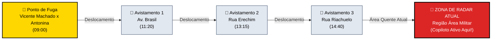

# 🧭 Roteiro Estratégico: Trilha Tática de Avistamentos & Radar Dinâmico de Pets

> **Status:** Documentado para Próxima Etapa (Não implementar código nesta fase)  
> **Idealizador:** Rigo (Diretoria Vórtice Mídia)  
> **Arquiteto:** Johan (Master Orchestrator)  
> **Data de Registro:** 24/11/2026  

---

## 1. Visão Geral & Problema que Resolve

Hoje, quando um animal desaparece em Cascavel, o registro fica associado ao ponto de fuga ou à residência do tutor (ex: *Rua Vicente Machado com Rua Antonina*). 

Entretanto, **animais em fuga estão em constante deslocamento**:
1. Um cão assustado ou gato desorientado caminha quilômetros em poucas horas.
2. O animal pode sair do Centro, cruzar a Avenida Brasil, descer pela Rua Erechim, seguir pela Rua Riachuelo e entrar na região da Área Militar / Ciro Nardi.
3. Se o aplicativo e o Copiloto continuarem alertando apenas no ponto original da fuga, motoristas e pedestres que estão passando onde o animal **realmente está agora** não recebem o aviso em tempo hábil.

---

## 2. A Solução: Trilha Dinâmica de Avistamentos ("Vi Aqui")

### Funcionalidades do Módulo:

1. **Botão Comunitário "Vi Aqui" / "Marcar Onde Vi":**
   - Disponível tanto no card do pet no feed quanto no card da bolha flutuante e no mapa.
   - O cidadão que cruzar com o pet toca em "Vi Aqui": o app captura as coordenadas GPS atuais e o horário exato.

2. **Mapa da Trilha (Timeline Visual):**
   - Acesso liberado tanto para o tutor desesperado quanto para toda a comunidade.
   - Exibe a linha do tempo conectando os pontos sequenciais:
     * Ponto de Fuga (Ícone de casa/alerta inicial).
     * Pontos intermediários com horário e foto/comentário se houver.
     * Ponto mais recente destacado como **"Última Posição Conhecida"**.

3. **Raio de Busca Dinâmico no Copiloto / Bolha Flutuante:**
   - O motor de proximidade do Copiloto transfere o raio de 500m do ponto de fuga para o **último avistamento válido** (janela de tempo móvel, ex: últimas 2 a 6 horas).
   - Ao passar de carro pela região da Área Militar, o Copiloto canta no áudio:
     > *"Atenção: Animal perdido avistado recentemente nesta via! Olhe ao redor."*

4. **Visão Tática na Mesa Operacional:**
   - Na Mesa Operacional do Rigo, a tela de *Gestão Pets* exibirá os vetores de deslocamento, permitindo auditar os avistamentos e coordenar resgates de forma cirúrgica.

---

## 3. Próximas Pautas de Alinhamento Técnico (Checklist Contínuo)

> [!IMPORTANT]
> **Lembretes Obrigatórios para Johan manter ativos com o Rigo:**
> 1. **Definição dos Áudios do Copiloto no Trânsito:** Validar por que em alguns cenários o áudio não tocou, calibrar a síntese de voz nativa e o sintetizador neural (`/api/falar`).
> 2. **Trilha Dinâmica de Avistamentos:** Iniciar planejamento da arquitetura de banco de dados e interface do mapa quando o Rigo der sinal verde.
> 3. **Moderação Anti-Trote para Avistamentos:** Critérios de confirmação (1 clique vs confirmação de 2 pessoas) para evitar deslocamento inútil de tutores.
